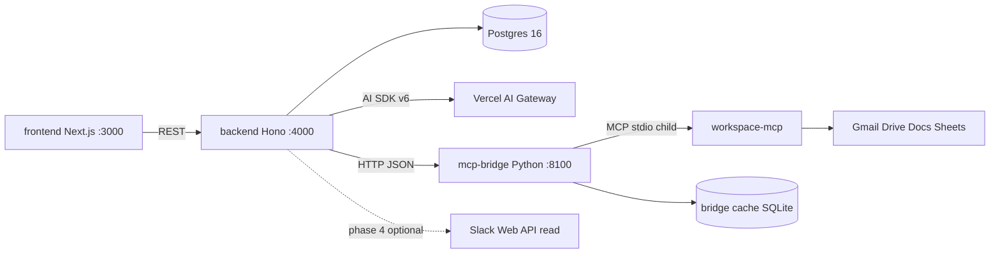

# EES end-to-end AI case app

## Decisions already made
- App is the brain: backend calls LLMs and MCP directly. Cursor MCP is no longer in the loop at runtime.
- No sending from the app. Every output is a copy-ready block. Existing `gate-mcp-writes.py` hook stays as a safety net for Cursor-side tooling.
- Multi-model via one gateway: AI SDK v6 `"provider/model"` strings through Vercel AI Gateway (`AI_GATEWAY_API_KEY`). Swappable to OpenRouter by changing one provider file.
- Model routing by task, configured in `.env`, defaults chosen from the live gateway model list at build time:
  - `MODEL_FAST`: intake classification, entity extraction, summarizing long emails/docs before reasoning
  - `MODEL_REASON`: investigation agent loop, root cause identification
  - `MODEL_WRITE`: customer email, exec Slack update, case note, resolution form prose

## Architecture

Compose services: `db`, `backend`, `frontend`, `mcp-bridge`. `mcp-bridge` is a Python container (`python:3.12-slim` + `uv`) that spawns `workspace-mcp --single-user` as a stdio child and exposes a small HTTP API to the backend. It reads `env_file: ${HOME}/.config/google-workspace-mcp/env` and mounts the existing token dir read-write (token refresh). Port 8000 published on localhost only for the OAuth callback. No Google secrets in the repo.

## Python MCP bridge (`mcp-bridge/`)

Purpose: give the LLM one fast, cached, parallel data path instead of 12 sequential MCP round trips. Backend stays the only writer of case state; the bridge is read-only.

- Stack: `uv` project, FastAPI + `mcp` Python SDK (`ClientSession` over `stdio_client`), `httpx`, SQLite TTL cache. One long-lived MCP session reused across requests.
- Endpoints:
  - `GET /health` and `GET /tools` (live tool list from workspace-mcp)
  - `POST /call { tool, args }` single call, cached by `sha256(tool+args)` with per-tool TTL (search 5 min, message/doc content 24 h)
  - `POST /batch [{ tool, args }]` runs with `asyncio.gather`, bounded by a semaphore (default 6)
  - `POST /prefetch/case { caseId, customer, subject, identifiers[], since }` fixed fan-out: Gmail search by customer + subject + each identifier, Drive search, optional Sheet lookup; then batch-fetches top N message bodies and returns a normalized evidence bundle `{ sources: [{ id, kind, title, from, date, snippet, text }] }` with text trimmed to `MAX_SOURCE_CHARS`
  - `POST /cache/invalidate { caseId }`
- Normalization: strips HTML and quoted reply chains from Gmail bodies, de-duplicates threads, orders by date. Every item keeps its original id so facts can cite `gmail:<id>` or `drive:<id>`.
- CLI for quick checks: `uv run bridge call search_gmail_messages '{"query":"from:x"}'`, `uv run bridge prefetch --customer "Acme" --subject "outage"`, `uv run bridge tools`.
- Files: `mcp-bridge/pyproject.toml`, `mcp-bridge/bridge/{server,mcp_session,cache,normalize,prefetch,cli}.py`, `mcp-bridge/Dockerfile`.

## Speed without losing quality

- Prefetch first, reason second: `investigate` calls `/prefetch/case`, fans out `MODEL_FAST` per-source summaries in parallel (cached in `evidence` table by source id + content hash), then gives `MODEL_REASON` a compact evidence pack. Target 1 to 3 agent steps instead of 12; the agent keeps bridge tools for follow-up queries only.
- Escalate only when needed: `MODEL_FAST` handles classify, extraction, and summaries. If schema validation fails or self-reported confidence is below threshold, retry once with `MODEL_REASON`. Skip the LLM entirely when the user already filled the fields.
- Parallel drafts: the three artifacts (exec Slack, customer email, case note) and the resolution form are generated concurrently with `Promise.all`; UI streams each block with `streamText` so first tokens appear within a second or two.
- Budget guards: max steps, max tool result chars, `maxOutputTokens` per task, and a per-case token ceiling surfaced in the UI. All recorded in `ai_runs`.
- Tool results are untrusted text: system prompt states it, and facts must cite an id that exists in the evidence pack (validated server-side, rejected otherwise).

## Case workflow (end to end)
1. Intake (`/cases/new`): paste customer email or describe issue. `MODEL_FAST` proposes caseType, severity, product, extracted identifiers (customer email, account/order ids). User confirms picklist values before save.
2. Investigate (`POST /cases/:id/ai/investigate`): backend calls bridge `/prefetch/case`, summarizes each source with `MODEL_FAST` in parallel, then runs a short `MODEL_REASON` agent loop (AI SDK `generateText`, max 4 steps) over the evidence pack. Follow-up tools = bridge `/call` wrappers for `search_gmail_messages`, `get_gmail_message_content`, `search_drive_files`, `get_doc_content`, `read_sheet_values`, plus internal `get_case`, `get_notes`. Output is a structured brief (facts each with `source` id, timeline, open questions, root cause hypothesis) validated by zod and `PUT` to investigation.
3. Resolve: user or AI sets `rootCause` (picklist), resolution steps, status.
4. Draft (`POST /cases/:id/ai/draft { kind }`): `exec_slack`, `customer_email`, `case_note`. `MODEL_WRITE` writes from case + investigation + notes only. Saved as `draft` communication or note; UI shows Copy button per block.
5. Resolution form (`POST /cases/:id/ai/resolution`, `GET/PUT /cases/:id/resolution`): case number, issue identification (caseType, rootCause, affected product), resolution summary, actions taken, status, customer-facing summary. Rendered as copy-ready plain text, markdown, and JSON.
6. Cost tracking: every AI call writes an `ai_runs` row (caseId, task, model, inputTokens, outputTokens, durationMs, steps). Case screen shows per-case token totals.

## Data model additions
- Keep: `cases`, `investigations`, `notes`, `communications`, `picklists` as in `.cursor/skills/ees-app/reference.md`.
- Add `resolutions` (one per case): `caseId`, `issueSummary`, `rootCause`, `resolutionSummary`, `actionsTaken[]`, `customerSummary`, `status`, `updatedAt`.
- Add `ai_runs`: `id`, `caseId`, `task`, `model`, `inputTokens`, `outputTokens`, `durationMs`, `steps`, `ok`, `error`, `createdAt`.
- Add `evidence` (per case, per source): `caseId`, `sourceId` (`gmail:<id>` or `drive:<id>`), `kind`, `title`, `date`, `contentHash`, `summary`, `fetchedAt`. Reused across investigation runs when the hash is unchanged.

## API additions (on top of existing CRUD in ees-app skill)
- `POST /cases/:id/ai/classify`, `/ai/investigate`, `/ai/draft`, `/ai/resolution`
- `GET /cases/:id/ai-runs`, `GET/PUT /cases/:id/resolution`
- `GET /mcp/status` (proxies bridge `/health` + `/tools`), `GET /models` (current model map), `GET /cases/:id/evidence`
- Backend never logs email bodies, tool results, or keys. Unknown picklist values rejected with 400. Tool results are treated as untrusted data in the system prompt (prompt injection guard).

## Frontend
- `/` case list with status, severity, token cost. `/cases/new` intake with AI suggestions. `/cases/[id]` sections: Overview, Investigation (Run button + brief), Drafts (three copy blocks), Resolution form (edit + copy), Activity (notes, AI runs). `/picklists` admin. `/settings` read-only model map + MCP status.
- Copy blocks use `navigator.clipboard`; label every control; 44px targets; loading, empty, and error states.

## Key files
- `docker-compose.yml`, `.env.example` (`DATABASE_URL`, `PORT`, `NEXT_PUBLIC_API_URL`, `AI_GATEWAY_API_KEY`, `MODEL_FAST`, `MODEL_REASON`, `MODEL_WRITE`, `MCP_BRIDGE_URL`, `BRIDGE_MAX_PARALLEL`, `MAX_SOURCE_CHARS`, `EES_PICKLIST_SHEET_ID`)
- `backend/src/db/schema.sql`, `backend/src/routes/*.ts`
- `backend/src/ai/provider.ts` (gateway + model map), `backend/src/ai/tasks/{classify,investigate,draft,resolution}.ts`, `backend/src/ai/runs.ts`, `backend/src/ai/escalate.ts` (fast-then-reason retry)
- `backend/src/bridge/client.ts` (typed client for bridge `/call`, `/batch`, `/prefetch/case`; AI SDK tool wrappers)
- `mcp-bridge/pyproject.toml`, `mcp-bridge/Dockerfile`, `mcp-bridge/bridge/{server,mcp_session,cache,normalize,prefetch,cli}.py`
- `frontend/app/{page,cases/new/page,cases/[id]/page,picklists/page,settings/page}.tsx`, `frontend/components/CopyBlock.tsx`

## Repo guidance updates
- `.cursor/rules/ees-stack.mdc`: add `mcp-bridge/` (Python) to the layout; backend holds `AI_GATEWAY_API_KEY` and talks to the bridge; Google OAuth stays outside the repo; `.env` never committed.
- New `.cursor/rules/ees-bridge.mdc` (globs `mcp-bridge/**/*.py`): read-only tools only, cache every call, never log message bodies, bounded parallelism.
- `.cursor/skills/ees-app/SKILL.md` + `reference.md`: new service, routes, `Resolution`, `AiRun`, `Evidence` records; remove "no MCP client in container" from skipped list.
- `.cursor/skills/ees-case/SKILL.md`: investigation and drafts run through the app's AI endpoints; Cursor MCP is fallback when the app is down.
- Add `.cursor/commands/resolve-case.md` for the resolution form step.

## Build order
1. Scaffold compose, schema, backend CRUD, frontend screens, resolution form and copy blocks (works with no AI key).
2. Python bridge: `mcp-bridge` service with `/call`, `/batch`, `/prefetch/case`, cache, CLI; verify against real Gmail/Drive from the CLI.
3. AI layer: provider, model map, classify, draft, resolution, escalation, `ai_runs`.
4. Investigate: prefetch + parallel summaries + short reasoning loop, `evidence` table, source-id validation.
5. Optional later: Slack read adapter (`SLACK_BOT_TOKEN`) added as a bridge tool, picklist sync from Sheet via bridge.

## Blocked on you (fill in `.env` when ready, not needed to start)
- `AI_GATEWAY_API_KEY` (or an OpenRouter key if you prefer that gateway).
- Confirmation that `~/.config/google-workspace-mcp/env` can be reused by the compose service (read-only mount).